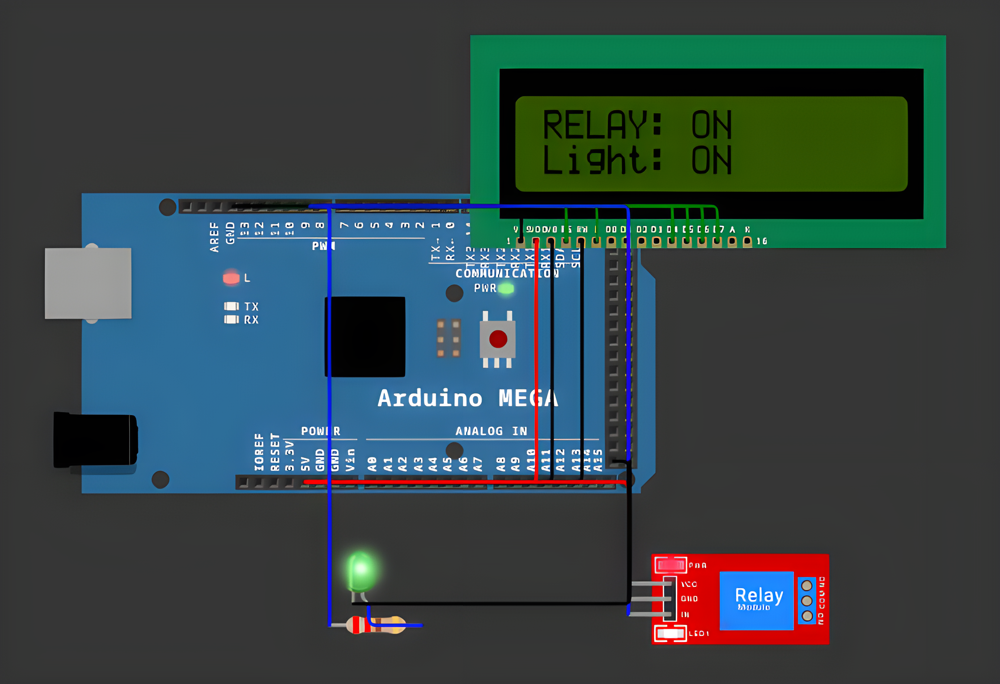

# Relay Control System

<table align="center">
  <tr>
    <td align="center">
      
    </td>
  </tr>
</table>

## Overview

Relay Control System is an embedded application for Arduino Mega that switches a light bulb through
an electromagnetic relay. Commands (`ON`, `OFF`, `STATUS`) are received over the serial port,
validated, executed, and confirmed with JSON messages, a 16x2 LCD and two indicator LEDs.

## Features

- **Relay Control**: Drives a relay module on pin `8` that switches the bulb. The module is
  active-LOW, so the relay is energized by writing `LOW` on its input.
- **Serial Commands**: Accepts `ON`, `OFF` and `STATUS`. Commands are trimmed and case-insensitive
  (`on`, `On` and `ON` are equivalent).
- **Buffered Input**: Characters are accumulated in a buffer until the `\n` terminator is received;
  `\r` is ignored, and the buffer is protected against overflow (256 characters).
- **JSON Responses**: Every command is answered with a JSON message, and invalid commands return an
  error that lists the valid ones.
- **Periodic Status Report**: Every 10 seconds the current state is printed as
  `{"relay":"ON/OFF","bulb":"ON/OFF","timestamp":...}` and the LCD is refreshed.
- **Multimodal Feedback**: The LCD shows the relay and bulb state, a green LED on pin `9` mirrors the
  relay, and the onboard LED on pin `13` is used for debugging.
- **Clean Architecture**: Relay, LCD and serial communication are separate modules, each with its own
  header and implementation file; private state is hidden with `static` variables.
- **Coding Standards**: CamelCase naming and no magic numbers (pins and timings are named constants).

## Technologies

- **Platform**: Arduino Mega 2560
- **Language**: C++ (Arduino Framework)
- **Libraries**: LiquidCrystal
- **Build System**: PlatformIO
- **Simulation**: Wokwi
- **Development Tools**: Visual Studio Code + PlatformIO IDE
- **Version Control**: Git, GitHub

## Project Structure

```
src/
├── lcd_display/
│   ├── LcdDisplay.cpp
│   └── LcdDisplay.h
├── relay_control/
│   ├── RelayControl.cpp
│   └── RelayControl.h
├── serial_comm/
│   ├── SerialComm.cpp
│   └── SerialComm.h
└── main.cpp
diagram.json
wokwi.toml
platformio.ini
```

## Pin Mapping

| Component | Pin | Action |
|---|---|---|
| Relay module (IN) | 8 | Switches the bulb (active-LOW) |
| LED Green | 9 | Mirrors the relay state (through a 220 Ω resistor) |
| LED Onboard | 13 | Extra feedback for debugging |
| LCD RS | 12 | Register select |
| LCD E | 11 | Enable |
| LCD D4 – D7 | 5, 4, 3, 2 | 4-bit data lines |

Relay module power and bulb circuit: `VCC → 5V`, `GND → GND`, `COM → 5V (bulb supply)`,
`NO → bulb → GND`. All components share a common ground.

## Serial Interface

Serial settings: **9600 baud, 8N1**. Every command must end with a newline (`\n`).

| Command | Effect | Response |
|---|---|---|
| `ON` | Relay energized, bulb on | `{"result":"OK","action":"RELAY ON","bulb":"ON"}` followed by a status report |
| `OFF` | Relay released, bulb off | `{"result":"OK","action":"RELAY OFF","bulb":"OFF"}` followed by a status report |
| `STATUS` | No change | Status report |
| anything else | No change | `{"error":"UNKNOWN COMMAND","cmd":"...","valid_commands":["ON","OFF","STATUS"]}` |

Example session:

```
> ON
{"result":"OK","action":"RELAY ON","bulb":"ON"}
{"relay":"ON","bulb":"ON","timestamp":12034}
> STATUS
{"relay":"ON","bulb":"ON","timestamp":15210}
> TOGGLE
{"error":"UNKNOWN COMMAND","cmd":"TOGGLE","valid_commands":["ON","OFF","STATUS"]}
```

## LCD Output

| State | Line 1 | Line 2 |
|---|---|---|
| Startup (1 s) | `Lab4.1 Mega2560` | `Awaiting command` |
| Relay ON | `RELAY: ON` | `Bulb: ON` |
| Relay OFF | `RELAY: OFF` | `Bulb: OFF` |

## Configuration

| Parameter | Value | Description |
|---|---|---|
| `RelayPin` | 8 | Relay module input |
| `LedPin` | 9 | Green indicator LED |
| `LedStatusPin` | 13 | Onboard LED |
| `StatusReportIntervalMs` | 10000 ms | Period of the automatic status report |
| `SerialBaudRate` | 9600 | Serial monitor speed |
| `SerialBufferMaxSize` | 256 | Maximum command buffer length |

## Resources

- [Wokwi Documentation](https://docs.wokwi.com/)
- [Arduino Serial Reference](https://www.arduino.cc/reference/en/language/functions/communication/serial/)
- [Arduino LiquidCrystal Library](https://www.arduino.cc/reference/en/libraries/liquidcrystal/)
- [PlatformIO Documentation](https://docs.platformio.org)

## Installation

To build and run the application, follow these steps:

1. **Clone this repository:**
```bash
git clone https://github.com/Constantin-Stamate/relay-actuator-control
```

2. **Navigate to the project directory:**
```bash
cd relay-actuator-control
```

3. **Open the project in VS Code with the PlatformIO extension installed**

4. **Build and upload to the board (or run the Wokwi simulation):**
```bash
pio run --target upload
```

5. **Open the serial monitor and send commands:**
```bash
pio device monitor -b 9600 --eol LF
```

```
Type ON / OFF / STATUS and press Enter -> the relay switches, the LED and LCD follow,
                                          and a JSON message is printed over Serial
```

## Contributors

**Relay Control System** was developed as part of the Internet of Things laboratory works.

- GitHub: [Constantin-Stamate](https://github.com/Constantin-Stamate)
- Email: constantinstamate.r@gmail.com